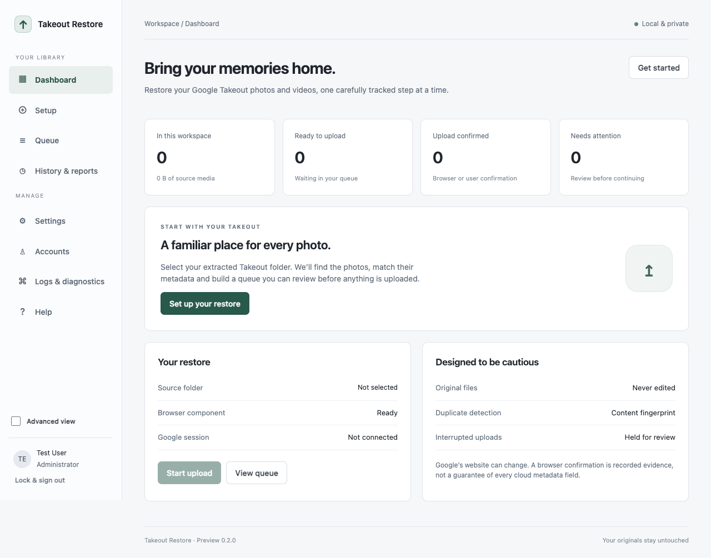

# Takeout Restore

A local desktop application for scanning extracted Google Photos Takeout folders,
merging supported metadata into temporary copies, and operating a durable upload
queue through the Google Photos website. The interface has Simple and Advanced
views and separate local user accounts.

**Status: engineering preview, not a certified or production-validated restoration tool.**
No application can promise perfect or exactly-once restoration through an external
website. Test a small sample and keep your independent Takeout backup.



## Google sign-in: original Chrome/CDP flow (0.1.1)

The app now follows the original pipeline: launch a dedicated Chrome process, let the
user sign in manually, then attach with `connect_over_cdp()` and reuse Chrome's default
context. Installed Google Chrome is preferred. The downloaded browser is a fallback.
No terminal commands or a manually configured debugging port are needed.

In Setup, choose **Open Chrome sign-in**. Complete sign-in in that dedicated window.
Once Google Photos opens, return to the app and choose **I’ve signed in — Continue**.
The app attaches only after confirmation. Each local user has a separate profile,
encrypted between operations; Chrome closes when the operation finishes.

Google may still reject a browser with **“This browser or app may not be secure.”**
The app detects that as GPP-410. The previous Playwright-launch sign-in failure does
not establish whether this original CDP route will work for your account. A real
Google login must be tested by the user; offline checks do not establish that.

Google's explanation: https://support.google.com/accounts/answer/7675428?hl=en

## Backup quality (0.1.2)

When Google Photos displays **Choose your backup quality**, the app selects
**Original quality**, verifies that it is checked, and clicks **Continue**. This applies
during setup, connection checks and upload processing, including repeated prompts.
There is no Storage saver option in the app. If selection cannot be verified, GPP-414
stops the operation; a submitted item's outcome remains held for review. This handles
the prompt; it is not a general editor for Google account settings when no prompt appears.

## Logs, upload outcomes and macOS installation (0.1.3)

Logs now has **Export logs as CSV** in Simple and Advanced view. It exports every
current-user audit event with UTC timestamps, structured details, error explanations
and audit hashes. A finished operation is distinct from confirmed uploads: unresolved
items produce Review required, and an empty eligible queue cannot start another upload.
Future browser errors retain a redacted stage and exception cause type.

The macOS DMG has a fixed Finder window layout, app and Applications icons, an arrow
and installation instructions. Copy the app to Applications, open that installed copy,
and eject the disk image. The bundle has explicit Apple application metadata and a
once-per-version refresh through Apple's public Launch Services registration API.
Spotlight indexing still depends on macOS settings and index availability.

## Upload confirmation (0.1.4)

The completion matcher recognizes Google's **You backed up 1 item** card, including
wrapped text and whitespace variations. It still rejects other item counts and stale
confirmations. The queue records confirmation before attempting to dismiss that card
and advance. Card dismissal is restricted to a nearby Add to album/Close container;
unrelated global Close buttons are left alone. Existing Needs review records are not
automatically retried: verify those files in Google Photos first.

## What is implemented

- Native application window using Python + pywebview and the OS web renderer;
  no Electron, local application HTTP API or terminal needed by end users. CDP uses a temporary loopback-only browser debugging port.
- Dashboard, guided Setup, paginated/searchable Queue, History and CSV reports,
  Settings, Accounts, audit Logs, diagnostics and Help.
- Administrator and standard accounts, Argon2id password hashes, persistent
  failed-login throttling, role checks on the backend, inactivity lock and account
  disable/reset/password-change operations. First account is the administrator.
- Independent per-user databases, settings, queues and Google account bindings.
  Saved Google browser storage is encrypted using a random key
  wrapped by a password-derived scrypt key. Google passwords are entered at Google.
- Streaming SHA-256 fingerprints; disk-backed sidecar index; exact-name or unique
  title matching; malformed/ambiguous metadata rejection; edited-copy preferences;
  duplicate album occurrence preservation; size and pixel checks; bounded scratch use.
- Copy-only metadata processing using bundled ExifTool, including UTC dates,
  GPS coordinates and supported descriptions. Dates/descriptions/GPS are read back.
- Single-item browser uploads, Google-account matching, a no-upload connection
  check, selector fallbacks and explicit confirmation evidence. “No items uploaded”
  never means success. Unknown outcomes require review before retrying.
- SQLite WAL transactions, crash recovery, cooperative pause, manual retry/skip/
  verification, rotating structured logs, a SHA-256 audit chain, CSV injection
  protection and diagnostic bundles that omit media paths, filenames and sessions.
- Checksum-verified first-run browser installation. ExifTool includes its Perl
  runtime. PyInstaller packaging and GitHub Actions for Windows x64, macOS arm64/
  x64 and Linux x64, including signed-release workflow integration.

## Restoration boundaries

| Area | Preview behavior |
|---|---|
| Source files | Never intentionally edited or deleted; only staged copies are modified |
| Embedded dates, locations, descriptions | Written where the format supports them; write failures stop the item |
| Google dates/captions/location display | Must be checked in Google; embedding a tag does not force Google's interpretation |
| Albums | Album intent and duplicate occurrences recorded; automated cloud album recreation is **not implemented** |
| Favorites and archived state | Preserved in the report; cloud mutations are **not implemented** |
| Live/Motion Photos | Paired files processed adjacently; native cloud pairing is **not implemented** |
| Duplicates | Local workspace deduplication only; the existing Google library is not indexed |
| Upload evidence | Browser confirmation or explicit user verification; no server-side checksum proof |
| Retry | Bounded backoff for pre-submission connection failures; other failures need manual retry; uncertain submissions are never retried automatically |
| Input | Extracted folders only; ZIP input, incremental file watchers and legacy database import are not implemented |
| Languages | App and automation controls currently use English; international filenames/descriptions supported |
| Host security | App-level account separation, not a security boundary against someone controlling the same OS account |

These boundaries are also shown in the interface. Items requiring cloud-only
restoration get **Restore details**, not a false claim of complete restoration.
Google may reject automated browser login; this app does not bypass that restriction.

## End-user workflow

1. Install the package for your system and open **Takeout Restore**.
2. Create the first local account. The username is separate from your Google identity.
3. In Setup, select an extracted Takeout folder, scan it and inspect the queue.
4. In Setup, open the dedicated Chrome sign-in window. Complete sign-in, return to the app, and click **I’ve signed in — Continue**. Run the connection check afterwards.
5. Choose **Upload sample** to upload at most five ready items; verify dates, locations and video playback in Google Photos.
6. Start the remaining queue. Pause before disconnecting the source drive or closing.
7. Review uncertain uploads and restoration tasks. Export a report when finished.

Keep the computer awake. Pausing waits for an already-submitted item; large videos
can take hours. If the process or computer is killed, any submitted item is held for
review at next login. Files staged before submission return to Ready.

## Build and development

See [BUILDING.md](docs/BUILDING.md) for platform dependencies, packages and build
commands, and [SIGNING.md](docs/SIGNING.md) for protected signing automation.

For development with Python 3.12, from an activated virtual environment:

```sh
python -m pip install -r requirements-dev.txt
python -m pytest -q
python -m ruff check photorestore
python scripts/prepare_exiftool.py
python scripts/prepare_browser.py
python pipeline.py
```

Unix **build machines** need a C compiler and make to build the bundled Perl runtime. Installed
apps do not need Python, pip or a separately installed ExifTool/Perl. A development
checkout can explicitly set `TAKEOUT_DEV_EXIFTOOL` to an existing tool, and
`TAKEOUT_DEV_DATA` to a disposable data folder; frozen apps ignore these overrides.

## Data, security and support

Data defaults to the OS application-data directory for `TakeoutRestore`; it is not
stored alongside the source media. See [SECURITY.md](SECURITY.md) for the threat model
and [error catalogue](docs/ERRORS.md) for recovery guidance. Use **Advanced view →
Logs & diagnostics → Export diagnostics** to prepare a redacted support bundle.
Review it before sharing. Library reports intentionally contain personal filenames.

No telemetry is added. Browser setup downloads from the Playwright/browser vendor;
Windows Setup may download WebView2 from Microsoft; Google sign-in/upload contact
Google and its supporting services. These are exceptions to the earlier
“Google-only network traffic” proposal required by Option A.

The old script is archived, with its personal source path redacted, in
[legacy-pipeline.py.txt](docs/legacy-pipeline.py.txt). Its shared database is not
imported automatically because it can contain incorrectly confirmed uploads.

Apache-2.0 for original project code; see [LICENSE](LICENSE) and [NOTICE](NOTICE).


## Layout, recovery and removal (0.1.5)

Long log details, paths and errors wrap within the window; log-detail cells scroll
vertically for unusually large events. Controls wrap and the sidebar scrolls in short
windows. The UI is checked at 820, 960, 1180 and 1580 pixels wide, with an additional
native WebKit layout check in the packaged offline self-test.

Settings now provides **Reset to default settings**, **Clear all data**, and
**Uninstall**. Reset affects the current user's preferences; clearing data affects all
local app accounts. On macOS uninstall also moves the installed app to Bin and closes.
On Windows/Linux, clear data here and remove the app with the OS app manager.

**Forgot password?** accepts a recovery key and preserves history and saved Google
sign-in. Keys are shown once on the next successful sign-in after upgrading; save them
privately. Accounts can issue a replacement after checking the current password.
**Start over on this Mac** lets a locked-out user erase app data after macOS device
verification. See [macOS installation/removal](docs/MACOS-INSTALLATION.md) and
[security model](SECURITY.md) for scope and limitations. Existing data is migrated;
installing the update does not erase your accounts or upload history.


## Version 0.2.0: usage and incident reports

Start with [the non-technical usage guide](USAGE.md), also available through Help →
Read the full usage guide in the app. Setup and the sign-in waiting screen explicitly
say to keep the dedicated Chrome window open, return to Takeout Restore, and click
**I’ve signed in — Continue** after Google Photos is visible.

Logs now has **Send report** next to **Export logs as CSV**. Unexpected app/component/
website outcomes can offer an incident dialog. The user reviews the disclosure, saves
a redacted ZIP, and opens a prefilled email draft to `sarthakg043@gmail.com`. macOS uses
the native compose-email sharing service with the ZIP; the portable mailto fallback
requires manual attachment. No email is sent automatically. The report includes version,
a source/dependency build fingerprint, installed launcher SHA-256, incident details and
summary counts, excluding media, source filenames/paths, credentials and raw databases.

[Apple release instructions](docs/APPLE-RELEASE.md) cover tests, Developer ID signing,
notarization/stapling, secure CI and the separate Mac App Store readiness work. This
browser-downloading, unsandboxed preview is **not ready for Mac App Store submission**;
notarizing its DMG does not grant App Store acceptance.
