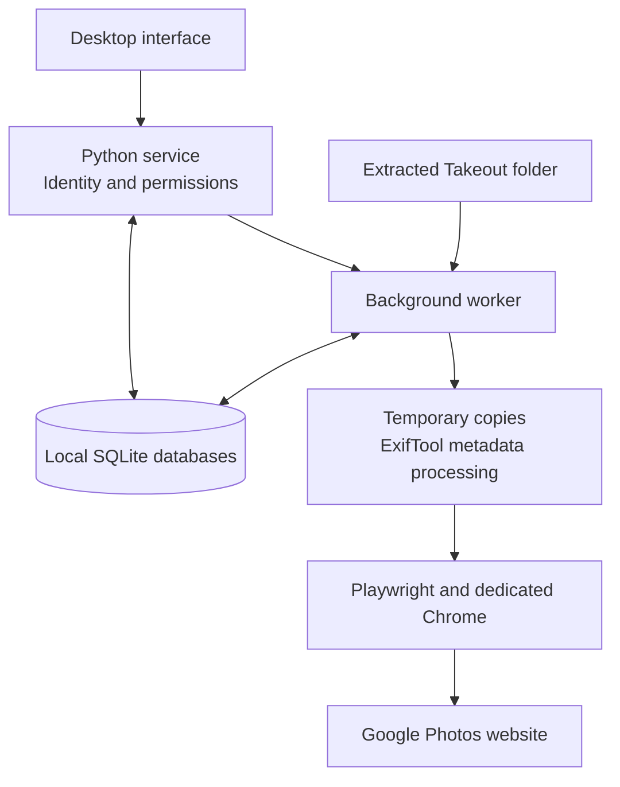
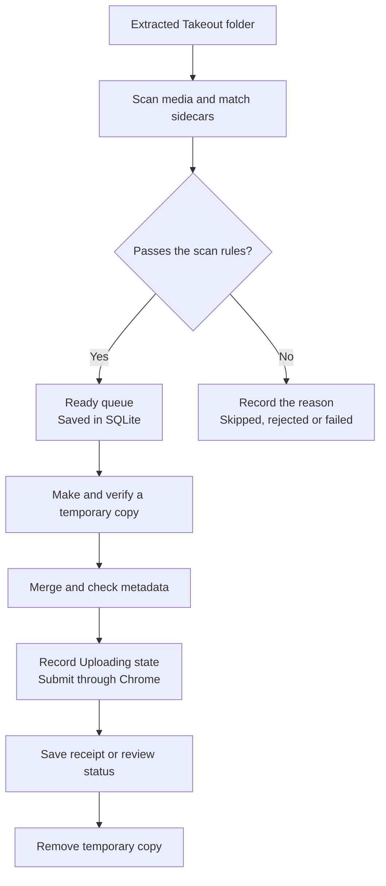
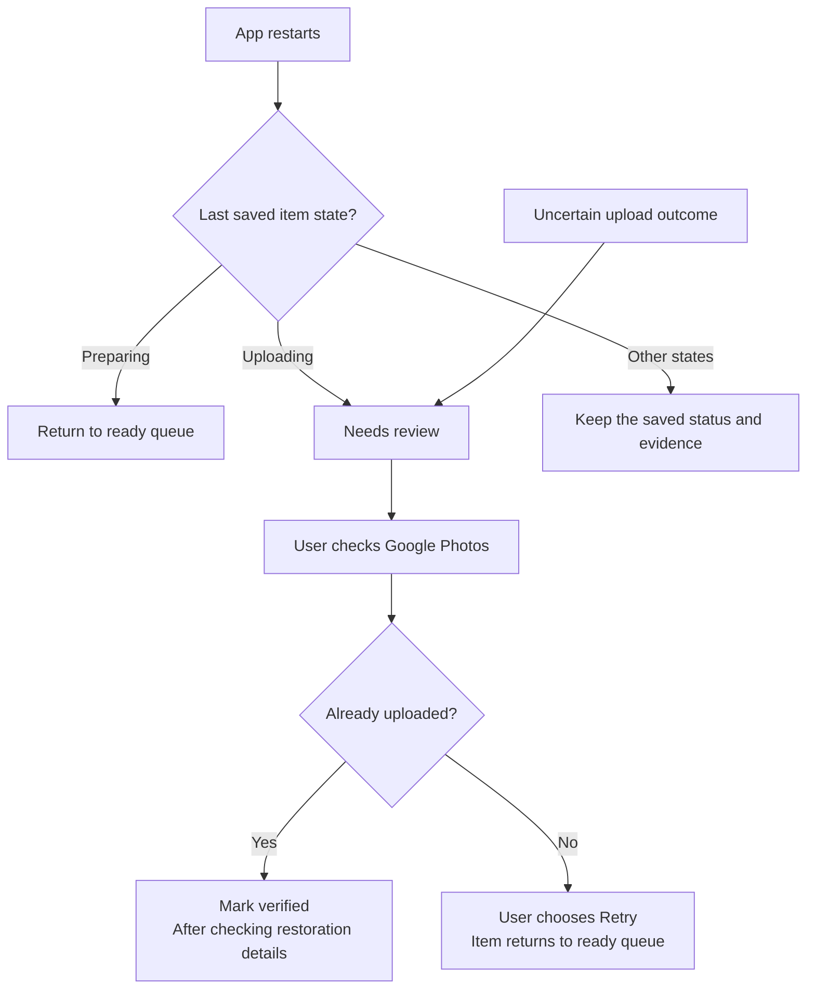
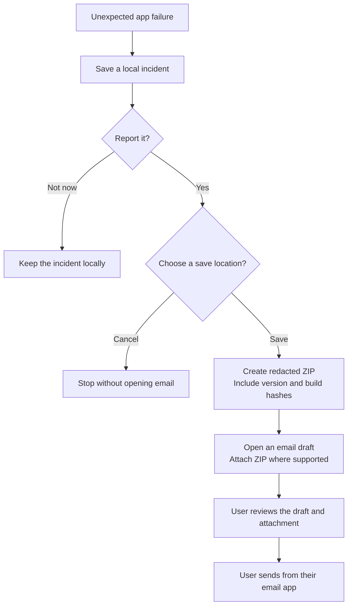

# Inside Takeout Restore: from a Takeout folder to Google Photos

*A high-level developer overview of version 0.2.0.*

A Google Takeout export can contain a photo and a separate JSON file describing its date, location and other details. That extra file is called a **sidecar**. Uploading the photo alone can leave useful information behind.

Takeout Restore brings these pieces together. It scans an extracted backup, matches media to metadata, prepares temporary copies and uploads through Google Photos in Chrome. A local queue records each item's progress so the user can understand what happened after an interruption.

The central design choice is simple: **preserve the originals, record progress, and ask for review when an upload outcome is uncertain.**

## 1. The main building blocks

The interface uses HTML, CSS and JavaScript inside a native window provided by **pywebview**. Python handles authentication, configuration, scanning, metadata processing and uploads. SQLite databases hold accounts and each user's queue, history and settings.

The service is the interface's entry point into the engine. It validates requests and decides which actions the current user may perform. Long operations run in a background worker, allowing the interface to display progress and request a safe pause.

The desktop interface communicates through an in-process bridge. Browser automation separately uses a temporary, loopback-only Chrome debugging connection. Keeping these responsibilities separate makes the browser adapter easier to update when Google's website changes.

## 2. Follow one photo through the system

Imagine an extracted folder containing `holiday.jpg` and its matching metadata sidecar. The app first works out which information belongs to that photo. It then creates a queue record containing the file's identity, metadata, status and any warnings.

Matching is deliberately cautious. Missing sidecars produce a warning while existing embedded metadata is retained. Malformed or ambiguous metadata produces an error rather than an arbitrary match.

Before upload, the engine checks that the source still matches the scanned file and that sufficient working space is available. **ExifTool modifies the temporary copy**, then reads supported dates, locations and descriptions back to check the write. The source file remains intact.

Duplicate detection uses local records, with content hashing as the default. It does not search the user's entire existing Google Photos library.

## 3. Chrome sign-in is a user-controlled handoff

The app launches a dedicated Chrome window with a separate profile. The user signs in directly on Google's pages, waits until Google Photos is visible, **keeps Chrome open**, returns to Takeout Restore and clicks **I've signed in — Continue**.

Only then does Playwright attach through **CDP**, Chrome's browser-control connection. The app uses that authenticated browser to check the account and operate the website's upload controls. Installed Chrome is preferred; a checksum-verified browser download is available as a fallback.

Uploads run one item at a time. When Google presents the backup-quality prompt, the app selects and checks **Original quality**. It also looks for a completion message, such as “You backed up 1 item,” and saves the browser receipt before advancing.

These are observations of an external website. Google can change its interface, reject a session or display information differently, so a small sample upload remains an important part of setup.

## 4. Recovery starts with knowing what was saved

The difficult case is a connection loss after submission: Google might have received the file even though the app never recorded a confirmation. Automatically submitting it again could create a duplicate.

The engine therefore saves an **Uploading** state before handing the file to the browser. On restart, the saved state determines the next step.

Explicit rejection and preparation errors are recorded as failures with error codes. Unknown submission outcomes are held for review. Some connection failures before submission can be retried with a bounded delay.

Pausing follows the same cautious approach: it cooperates with the worker and allows a submitted upload to finish. This design supports recovery, but it cannot guarantee exactly-once delivery across both a local database and Google's website.

## 5. Local accounts and Google sessions have different roles

A local account controls access to a workspace. Each user has separate settings, queue, history and saved Google session. Administrators manage local users and destructive actions; the **Advanced view** switch exposes more interface detail without granting administrator rights.

Local passwords are stored as hashes. A random profile key protects saved Google credentials, and that key is wrapped using a password-derived key. The dedicated Chrome profile is encrypted between operations and temporarily unlocked while Chrome runs.

A password change or valid recovery key preserves the profile key. An administrator password reset replaces it and removes the saved Google sign-in while keeping history. Queue records and filenames are stored locally in plaintext, so separate operating-system accounts provide stronger isolation than sharing one OS login.

## 6. Diagnostics should help without sending someone's library

The app records structured events and stable error codes. Its audit entries link to previous entries using hashes, making edits detectable when compared with trusted earlier records. Someone who controls all local files can still rewrite the chain.

Unexpected failures can offer an incident report. The user chooses whether to create and share it.

The ZIP excludes media, source filenames and paths, passwords, recovery keys, browser sessions and raw databases. It identifies the build and observed failure, while making clear that the root cause may still be unknown. The app never sends the email automatically.

## 7. Large backups and practical limits

The scanner indexes sidecars on disk and hashes files in chunks. Queue pages load a limited number of records, and uploads prepare one temporary item at a time. This keeps memory use manageable as a backup grows, while still requiring time, working disk space and a reliable connection.

Supported embedded metadata can be restored automatically. Album membership, favorites, archive state and paired-photo relationships are recorded for review; this version does not automatically apply those Google-only features. Native Live Photo pairing is not implemented. Users should also check how Google displays the embedded metadata.

## 8. From code to a desktop download

**PyInstaller** packages Python, the interface, ExifTool and their dependencies into platform-specific applications. The interface reuses the operating system's web renderer. A fallback Chrome download is installed separately when needed.

GitHub Actions defines Windows, macOS and Linux build jobs. Each platform needs its own build and validation. The published 0.2.0 release includes an Apple Silicon Mac DMG with Developer ID signing and Apple notarization. Those checks identify the publisher and verify the distribution artifact; restoration behavior still depends on the app, input files and Google's website.

## Where to look in the code

| Area | Starting point |
| --- | --- |
| Native window and local interface | [`app.py`](../photorestore/app.py), [`ui/`](../photorestore/ui/) |
| Request validation and operations | [`service.py`](../photorestore/service.py) |
| Scanning and sidecar matching | [`scanner.py`](../photorestore/scanner.py), [`metadata.py`](../photorestore/metadata.py) |
| Staging and upload decisions | [`engine.py`](../photorestore/engine.py) |
| Chrome and Google Photos controls | [`chrome.py`](../photorestore/chrome.py), [`browser.py`](../photorestore/browser.py) |
| Accounts and durable records | [`auth.py`](../photorestore/auth.py), [`store.py`](../photorestore/store.py) |
| Incident reports and email drafts | [`support.py`](../photorestore/support.py), [`maildraft.py`](../photorestore/maildraft.py) |

For day-to-day operation, read the [usage guide](../USAGE.md). For the detailed trust boundaries, read the [security model](../SECURITY.md). Packaging, Developer ID signing and Apple notarization are covered in the [Apple release guide](APPLE-RELEASE.md).

All four diagrams are embedded as fenced `mermaid` blocks. GitHub renders them in the Markdown view, and the same blocks can be copied into a Mermaid-compatible editor for changes.
